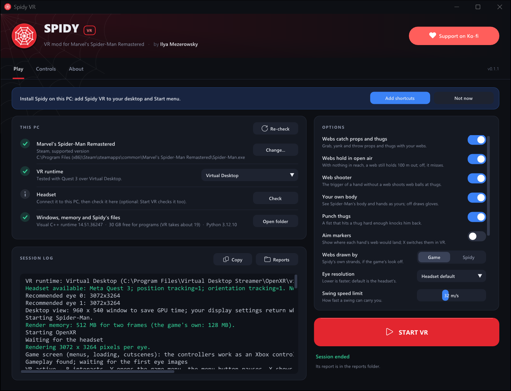

<p align="center">
  <a href="https://github.com/IlyaMez/SpidyVR/releases/latest"></a>
</p>

<h1 align="center">Spidy</h1>

<p align="center">
  <b>VR for Marvel's Spider-Man Remastered</b><br>
  Swing on webs with your own arms, shoot from your wrists, punch with your fists.
</p>

<p align="center">
  <a href="https://github.com/IlyaMez/SpidyVR/releases/latest"></a>
  <a href="https://discord.gg/x27ZXDpdNt"></a>
  <a href="https://ko-fi.com/ilyamezerowsky"></a>
</p>

<p align="center">
  <a href="https://github.com/IlyaMez/SpidyVR/releases/latest"></a>
  <a href="https://github.com/IlyaMez/SpidyVR/releases"></a>
  <a href="https://github.com/IlyaMez/SpidyVR/stargazers"></a>
  <a href="https://discord.gg/x27ZXDpdNt"></a>
</p>

<p align="center">
  <a href="#install-and-play">Install</a>
  ·
  <a href="#controls">Controls</a>
  ·
  <a href="#troubleshooting">Troubleshooting</a>
  ·
  <a href="docs/PLAYERS.md">Players' guide</a>
  ·
  <a href="docs/WALL_CRAWLING.md">Hand wall crawling</a>
  ·
  <a href="docs/CHANGELOG.md">What's new</a>
</p>

Spidy is a free fan mod by **Ilya Mezerowsky** that puts Marvel's Spider-Man
Remastered in VR: native stereo at your headset's resolution, 6DoF head and
hands, and web swinging you control with your arms. One zip, one launcher,
one **START VR** button.

<p align="center">
  <a href="https://www.youtube.com/watch?v=krQd75OXMik"></a>
  <br>
  <sub>Recorded in the headset on Quest 3: this is how it plays. <a href="https://www.youtube.com/watch?v=krQd75OXMik"><b>Watch the trailer on YouTube</b></a></sub>
</p>

> **Early and in development.** Played on Quest 3 through Virtual Desktop.
> Spidy supports one Steam build of the game; a game update needs a Spidy update.

## Features

- **Physical web swinging.** Squeeze a grip to fire that hand's web from your
  web shooter where you point, swing on it, reel in with the trigger, pull
  sharply to zip (or swap the two: the trigger webs, the grip reels). Webs hold
  on buildings, the ground, or open air, and bend round corners. Swing low and
  you skim the street on a near miss. Take the web in your other hand and climb
  it hand over hand.
- **Web shooter and gadgets.** The trigger of a hand without a web fires the
  game's own web ball from your wrist, with aim assist on enemies. Three quick
  hits web an enemy up. Hold X and a wheel of your gadgets opens in front of
  your hand; pick one and the trigger fires it.
- **Grab and throw.** Web a prop or an enemy, reel or yank it in, swing it on
  the web and let go to throw it. Heavy things feel heavy. Pulled enemies fly
  flailing, and get hurt when they slam into walls, the ground or each other.
- **Punch across the room.** A fast fist into an enemy lands the game's own
  melee hit, harder the faster you swing. Throw one at an enemy up to 10 m
  away and you fly in and strike. Uppercut an enemy into the air and keep
  fighting up there; blows in a row build to a finisher.
- **Fights you read at a glance.** A ring marks the enemy your next punch goes
  to, and an arrow calls the blow: a hook, an uppercut or a blow down. A yellow
  arrow calls the finisher. Bursts, counts and **KO!** land where your blows do.
- **Slow motion.** Click the left stick and the world slows to a third while
  you keep full speed, for as long as the focus meter on your left wrist lasts.
  Finishers and perfect dodges slow time by themselves.
- **Walls are floors.** Walk at a wall, or fly or jump into it, and you stay on
  it: run along it, walk up it, jump off. Your view turns so the wall is your
  floor. Point at a vent or a door and press Y to go through.
- **You are Spider-Man.** Look down and see his body; his arms and hands
  follow your controllers, open, in a fist or in the web-shooting pose. A quick
  T-pose the first time sizes him to your height and arm length.
- **The game's prompts work in VR.** Press the button the game shows: X is its
  X, your triggers its LT, LB, RT and RB, the stick clicks its L3 and R3, the
  right stick its D-pad. While it asks for X, a punch is that X.
- **VR settings in the game's menu.** A SPIDY VR tab in the game's own
  Settings for aim markers, snap or smooth turning, vibration, swing speed,
  how heavy you swing, screen size, the HUD and more. Changes apply at once.
- **Menus and cutscenes on a screen.** Cutscenes in 3D: the game draws
  them once for each eye. The Touch controllers work as an Xbox controller
  there; VR resumes when play does. **SWITCH TO GAME SCREEN** in the pause
  menu plays the game as it is on that screen, whenever you like.
- **One launcher.** It checks the game, the headset and your PC, fixes what it
  can, starts VR with one button, and updates Spidy with one click.

## Join the community

<p align="center">
  <a href="https://discord.gg/x27ZXDpdNt"></a>
  <a href="https://ko-fi.com/ilyamezerowsky"></a>
</p>

### On Discord: where the players are

- **Release news first.** Every release is announced in `#spidy-updates`,
  with a ping if you ask for one.
- **Help and fixes.** Setup questions and bugs both go to `#spidy-bugs`, one
  forum for every problem, where you can see what is already known and fixed.
- **A say in what comes next.** Post and vote in `#spidy-ideas`: standing on
  walls, the dodge button and the flip speed setting were all asked for there.
- **Clips.** Show a swing in `#spidy-clips`, share your videos in
  `#spidy-socials`.

**[Join the Discord](https://discord.gg/x27ZXDpdNt)**

### On Ko-fi: what keeps it going

- **Spidy is free.** Every release, the whole mod, here on GitHub.
- **Tips pay for updates.** Spidy is built with a lot of AI help, and those
  tokens are the bill.
- **And for the next conversion.** More games in full VR, made to the same
  standard: native stereo, tracked hands, and the game's own systems in your
  hands.

**[Support Spidy on Ko-fi](https://ko-fi.com/ilyamezerowsky)**

## Watch and follow

<table>
<tr>
<td width="33%" align="center" valign="top"><a href="https://www.youtube.com/watch?v=krQd75OXMik"></a><br><b>The trailer</b><br><sub>Swinging with your own arms</sub></td>
<td width="33%" align="center" valign="top"><a href="https://www.youtube.com/watch?v=cnF_Ief2cYA"></a><br><b>Combat, reworked</b><br><sub>Called blows, finishers, fights in the air</sub></td>
<td width="33%" align="center" valign="top"><a href="https://www.youtube.com/watch?v=aq-DvGblB3Q"></a><br><b>Set up in five steps</b><br><sub>From the zip to your first swing</sub></td>
</tr>
</table>

<p align="center">
  <a href="https://www.youtube.com/@lianmez"></a>
  <a href="https://x.com/lianmez"></a>
  <a href="https://discord.gg/x27ZXDpdNt"></a>
</p>

Gameplay, release videos and guides go up on [YouTube](https://www.youtube.com/@lianmez) and
[X](https://x.com/lianmez). Made a video about Spidy? Post it in `#spidy-socials` on
[Discord](https://discord.gg/x27ZXDpdNt), and put this page's link in its description so players
find the real download.

## What you need

- **Marvel's Spider-Man Remastered on Steam.** An Epic Games Store copy of the
  same version is tried too, untested so far.
- **A PC VR headset with an OpenXR runtime.** Played on Quest 3 with
  [Virtual Desktop](https://www.vrdesktop.net/) and with SteamVR (Steam Link),
  and by players on a Steam Frame with its own button layout; other SteamVR
  headsets and Quest Link should work.
- **A gaming PC.** It need not be new: players report good performance on lower
  settings with PCs like a GTX 1080 and 16 GB of RAM.
- **Windows.** On Linux, Spidy runs inside the game's Steam Proton session: experimental, with its
  own steps in [docs/LINUX.md](docs/LINUX.md) (contributed by [sjrl2000](https://github.com/sjrl2000)).

## Install and play

Prefer to watch? [Set up Spidy in five steps](https://www.youtube.com/watch?v=aq-DvGblB3Q) on YouTube.

1. Download the zip from [Releases](https://github.com/IlyaMez/SpidyVR/releases/latest)
   and extract it to a folder you can write to, such as `Documents\Spidy`.
2. Start **Spidy Launcher.exe**. If Windows says it protected your PC, choose
   *More info*, then *Run anyway*.
3. Fix anything marked red. The launcher can install the Visual C++ runtime for
   you, and *Add shortcuts* puts Spidy VR on your desktop and Start menu.
4. Connect your headset, close the game, and press **START VR**. Pick your save
   with the VR controllers; VR takes over as soon as you play.

Keep the game window in front on the desktop: the game pauses behind other
windows. If the headset shows a still picture, click the game window once.

<p align="center">
  
</p>

<details>
<summary><b>What the launcher does</b></summary>

- Finds the game in your Steam libraries and checks it is the supported build.
- Finds the OpenXR runtime your headset is connected to (or the one you choose) and checks the headset.
- Checks the Visual C++ runtime and Spidy's own files.
- Starts the game with the larger render memory VR needs, in a small window that
  saves GPU time, without frame generation, vertical sync or ray-traced reflections, and puts your settings back afterwards.
- Gives each eye the game's own anti-aliasing and upscaling (*Upscaling* in its options; the game's DLSS setting does not reach the headset), and shows your left eye in the game window while you are in VR.
- Remembers your options (its Options tab, with profiles to save and share), and saves a report of every session in `reports\`.
- Offers each new Spidy release when it starts, and updates itself in place with one click.

</details>

Spidy changes nothing in the game's folder.

## Controls

<p align="center">
  <a href="docs/images/readme/controls-quest3.jpg"></a>
  <br>
  <sub>Quest 3 Touch Plus shown; Quest 2 and Quest Pro controllers have the same buttons. Steam Frame buttons are in the <a href="docs/PLAYERS.md">players' guide</a>.</sub>
</p>

| Do this | With |
|---|---|
| Shoot a web, swing on it | Squeeze a **grip**; release to let go |
| Reel in | **Trigger**, while that hand's web is attached |
| Zip | Pull the hand sharply away from the anchor |
| Climb a web | Put your free hand on the web you hold and squeeze its **grip**; let go with the lower hand, take the web higher up, pull |
| Shoot a web ball | **Trigger** of a hand without a web |
| Gadgets | Hold **X**: a wheel of your gadgets opens in front of that hand. Move the hand to one and let go of **X**; the free hand's **trigger** then fires it. The web shooter at the top gives you web balls again |
| Grab a prop or an enemy | Grip aimed at it; trigger reels it, a sharp pull yanks it, release throws it |
| Webs on the trigger instead | Set **WEB BUTTON** to TRIGGER in VR settings (or *Web button* in the launcher): the trigger shoots and holds webs, the grip reels and shoots web balls |
| Punch | A fast fist into an enemy. Throw it at an enemy up to 10 m away and you fly in and strike |
| Slow motion | Click the **left stick**; click again to end it. The ring on your left wrist shows the focus left |
| Walk and run / jump | **Left stick** / **A** (from the ground, a wall or a perch; no web zip in the air). Hold **A** on the ground to charge a leap and let go: the longer you hold, the higher; with the left stick, forward too |
| Scan (the game's R3) | Raise a hand to your temple and pull its **trigger** |
| One enemy at a time | A ring marks the enemy your next punch goes to: the one you look at. Hit that enemy and the ring locks on until the enemy is down (**KO!**); look squarely at another for a moment to change |
| Called blows | An arrow comes into the ring from the side your fist should come from: swing a hook from that side, an uppercut from below or a blow down from above, at arm's reach or from across the room. The yellow arrow into a jagged red ring calls the finisher |
| Walls | Walk at one, or fly or jump into it, and you stay on it: at speed you run along it, then stop. **Left stick** walks it (pushed at the wall: up it), **A** jumps off, a web pulls you off. Walking it or stopped, your view turns so the wall is your floor (STAND ON WALLS in VR settings or the launcher) |
| Flip (experimental, off by default: FLIPS and FLIP SPEED in VR settings or the launcher) | **Left stick** in the air: turns you over, as fast as you tilt it; let go to come back level. Tap **A** in the air: one flip toward where the stick points. Hold **A**: you stay turned while the stick rests |
| Turn | **Right stick**: snap 30° (adjustable or off), or hold to turn smoothly with SMOOTH TURN on in VR settings |
| Dodge (the game's B) | **B**, the way the **left stick** points; not while a web carries you |
| Interact (the game's Y) | **Y**, looking at the thing from within about a metre of it; hold **Y** and you step up to what you look at until the game takes it. On a wall, point a hand at a vent or a door (a turning ring in that hand's colour) and press **Y**. Swinging, **Y** is the game's web strike too (onto a car in a chase) |
| Any button the game asks for | The one of that name: **A**, **B**, **X**, **Y** as shown (**X** is then the game's X, not the menu); **LT** or **LB** your left **trigger**, **RT** or **RB** your right; **L3**, **R3** a stick's click; the **D-pad** the right stick pushed that way. While the game asks for X, a punch is that X; with X + A in the air, a fist thrown down is the Ground Strike |
| Pull a door or a grate (the game's LB + RB) | Click the **right stick**, or hold it; not while a web carries you |
| Heal (the game's D-pad down) | Push the **right stick** straight down and hold it a moment |
| Zip to a point, enter a vent (the game's LT + RT) | Push the **right stick** straight up and hold it, swinging too: the game takes you from your webs once its zip begins. No point to zip to? Keep holding: time slows as the game aims; look at a point and let go to zip there |
| Pause (VR settings: Settings > SPIDY VR) | **Menu** button, or hold both sticks in for a moment (under SteamVR a Quest's menu button opens SteamVR's dashboard) |
| Game menu (map, suits, skills) | **X** (while the game asks for its X, that X instead) |
| The whole gamepad, for a moment | Click both sticks (and let go): the grips are the game's LB and RB, the triggers its LT and RT, the right stick its D-pad; your webs are off meanwhile. Click both again, or press nothing for 20 seconds, to leave |
| Play the game as it is | Pause, **SWITCH TO GAME SCREEN** (under RESUME): the game on a 3D screen in the headset, the controllers an Xbox controller. **SWITCH TO VR** goes back |

**Aim markers** show where each free hand's web would go, blue for the left
hand and orange for the right: a ring holds, a dashed ring holds in open air,
a red cross misses, a turning ring of three arcs catches a prop or an enemy.
AIM MARKERS in VR settings (or *Aim markers* in the launcher) hides them.

## Troubleshooting

| Problem | Fix |
|---|---|
| "This game version is not supported" | The launcher's game line names your version and the fix. An older version or a changed `Spider-Man.exe`: in Steam, right-click the game > *Properties* > *Betas* > *None*, then *Installed Files* > *Verify integrity of game files*. A newer version needs a Spidy update. |
| The headset is not found | Connect it first, check the VR runtime in the launcher, press *Check*. |
| "VR needs administrator rights" (0.2.9 and older: "[WinError 5] Access is denied", then "No loaded player within three minutes") | Steam or the game runs as administrator, and Windows keeps other programs out of such a game. Choose *Restart as administrator* when the launcher asks (older versions: right-click Spidy Launcher > *Run as administrator*), close the game, press **START VR**. If that changes nothing, allow the Spidy folder in your antivirus. |
| The picture breaks up | Close the game and start it from the launcher, which gives it the render memory VR needs. |
| Low frame rate | Lower the game's own graphics settings (players get good frame rates on a GTX 1080 that way). Set *Upscaling* in the launcher to Balanced or Performance, then lower *Render resolution* or the streaming quality in Virtual Desktop. On a laptop, plug it in and choose its highest performance mode. 90 Hz paces more evenly than 120 Hz. |
| Blurry edges | Set *Upscaling* in the launcher to High or Off, then raise *Render resolution* above 100% (try 125%); both cost frame rate and memory. |
| Web balls fly when you meant to reel | The trigger (the grip with WEB BUTTON: TRIGGER) reels only while that hand's web is attached; on a hand without a web it shoots. |

More fixes are in the [players' guide](docs/PLAYERS.md). When you report a
problem, attach the session's report from the `reports` folder, on
[Discord](https://discord.gg/x27ZXDpdNt).

## Building from source

Needs Visual Studio 2022 C++ Build Tools with CMake and Ninja, and a Windows SDK.

```powershell
.\tools\bootstrap.ps1 -Observer   # dependencies, including Dear ImGui for the launcher
.\tools\build.ps1 -Observer       # build\windows-ninja
.\build\windows-ninja\spidy_tests.exe
.\tools\package.ps1               # dist\Spidy-<version>-win64.zip
```

`Launch Spidy VR.cmd` runs VR straight from a checkout, and `Launch Spidy Lab.cmd`
opens a standalone OpenXR swinging lab that needs no game. Releases are built on
GitHub: **Actions > Release > Run workflow**.

## How it works

Spidy loads its modules into the running game and renders two extra scene views
through the game's own renderer, one per eye, at the headset's resolution and
lens, then hands them to OpenXR. Swinging is Spidy's own rope physics steering
the game's mover against the game's collision world; the webs you see, the web
shooter's shots, thrown props and punches are the game's own systems, fed from
your tracked hands.

| Read more | |
|---|---|
| [Players' guide](docs/PLAYERS.md) | Setup, every control and fix (the zip's `README.txt`) |
| [Changelog](docs/CHANGELOG.md) | Every build: what changed, why, and what was measured |
| [Development notes](docs/DEVELOPMENT.md) | Launcher and release internals, tools, launch options, memory and graphics in VR, the lab |
| [Validation](docs/VALIDATION.md) | What passed locally, and what still needs a game or headset |
| [Web grab](docs/WEB-GRAB.md) · [Body](docs/BODY.md) | Design and measurements of those features |
| [Milestone 1](docs/MILESTONE-1.md) · [Reference](docs/REFERENCE.md) | Acceptance criteria, game research, sources |

## Contributing

Fixes and features are welcome as pull requests, one feature each.
[CONTRIBUTING.md](CONTRIBUTING.md) says how, and what applies when you run or
share your own build.

## Support Spidy

Spidy is free, and built with a lot of AI help whose tokens aren't. Two things
keep it moving:

- **[A tip on Ko-fi](https://ko-fi.com/ilyamezerowsky)** pays for Spidy's updates, and for more full VR
  conversions of this quality.
- **[The Discord](https://discord.gg/x27ZXDpdNt)** is where releases are announced, problems get
  solved, and your clips and ideas shape what comes next.

<p align="center">
  <a href="https://ko-fi.com/ilyamezerowsky"></a>
  <a href="https://discord.gg/x27ZXDpdNt"></a>
</p>

No tip to spare? A star on this page, or a clip of your best swing, helps
other players find Spidy.

Please share the original release zip with its credit intact, so players get
working files and know where updates come from.

<p align="center">
  <a href="https://github.com/IlyaMez/SpidyVR/releases/latest"></a>
</p>

Spidy is Copyright (C) 2026 Ilya Mezerowsky, and free software under the
[GNU General Public License, version 3](LICENSE).

Spidy is a free fan project, not affiliated with or endorsed by Insomniac Games,
Sony Interactive Entertainment, Marvel or Valve. Third-party licences are in
[THIRD_PARTY_NOTICES.md](THIRD_PARTY_NOTICES.md) and [docs/licenses](docs/licenses).
